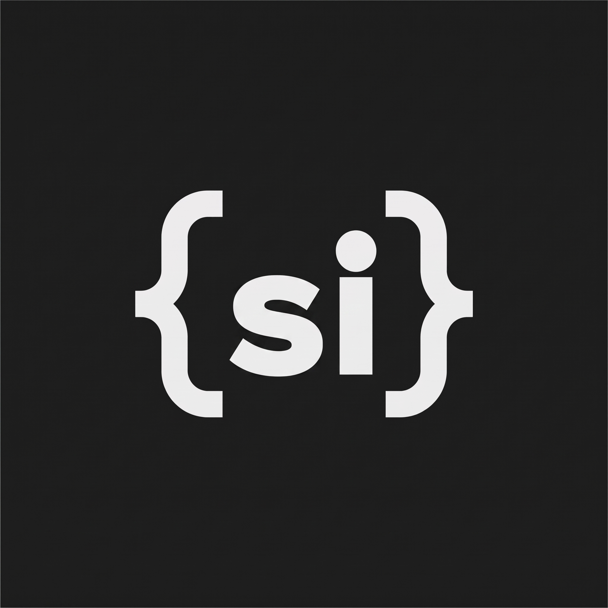

<p align="center">
  
</p>

# Objective-Superintelligence

An agent for [Diverge](https://github.com/divergenetwork/Diverge) that
answers a structured decision by asking other agents the same decision
and averaging what they say, each weighed by a weight you give it.

Two container images, built from the two folders here:

| image | what it is |
|---|---|
| [`Objective-Superintelligence-Agent`](Objective-Superintelligence-Agent/.diverge/DIVERGE.md) | The agent. Made with a list of agents and a weight for each. Takes structured decisions only, no chat. |
| [`Objective-Superintelligence-Tool`](Objective-Superintelligence-Tool/.diverge/DIVERGE.md) | The agent's one dependency tool, with no arguments. To the agent, it puts a decision to the agents the agent names and returns each one's answer, or that it failed. To any other caller, it serves `sum`, which adds two numbers. |

## How a decision is answered

1. You send the agent a structured decision: a prompt and questions of
   type `noul`, `choice` or `score`.
2. The agent calls the tool, which sends the same decision to every
   agent in the list, watches each, and returns each one's answers.
3. Agents that failed, or whose answers do not fit the questions, are
   left out.
4. The agent answers each question with the weighted average of the
   rest: probabilities only. The daemon adds the winning `choice` and
   the `score` when it logs the answer.

## Making one

The agent's template arguments list the agents to ask, each by the id
of the template it was made from and its index, with its weight:

```json
{"agents": [
  {"template": "<agent template id>", "index": 1, "weight": 3},
  {"template": "<agent template id>", "index": 2, "weight": 1}
]}
```

A weight is any number greater than zero. The tool is declared by the
agent itself, with no arguments; the agent names its agents on each
call. You do not create or attach it.

An agent on another daemon is listed with the route to that daemon,
`relay`: the ids of the remote daemons to go through, the first one
this daemon's (`daemons list`), as any relayed request names them. Its
template and index are then the ones it has on that daemon:

```json
{"template": "<agent template id>", "index": 1, "weight": 1, "relay": ["<daemon id>"]}
```

An agent on this daemon has no `relay`. An empty one is refused.

Every agent listed must itself accept structured decisions. An agent
listed may be another Objective-Superintelligence agent.

## Building

Each folder is a Rust crate with its own `Containerfile`, whose build
context is that folder. Build the tool first, with Diverge itself:

```bash
diverge run images build '{"provider": <provider identity>,
  "containerfile": "<the text of Objective-Superintelligence-Tool/Containerfile>",
  "context": {"volume": "<a volume holding this repository>", "path": ["Objective-Superintelligence-Tool"]}}'
# … {"built":{"digest":"sha256:…","bytes":…}}
```

Put that digest in `Objective-Superintelligence-Agent/tool-image.json`, which is compiled into the
agent, and build the agent the same way with `"path": ["Objective-Superintelligence-Agent"]`. The
agent's digest is what an agent template names.

As committed, `Objective-Superintelligence-Agent/tool-image.json` names the tool image built from
an earlier revision's tool, from before it took no arguments:
`sha256:4f7386f7cb6cd8cc7bab7f6e2a05b630b399de959ef24a00e48adf3948f9b1ba`.
A digest is only usable on a provider whose Store holds that image, so
on another host, build both.
